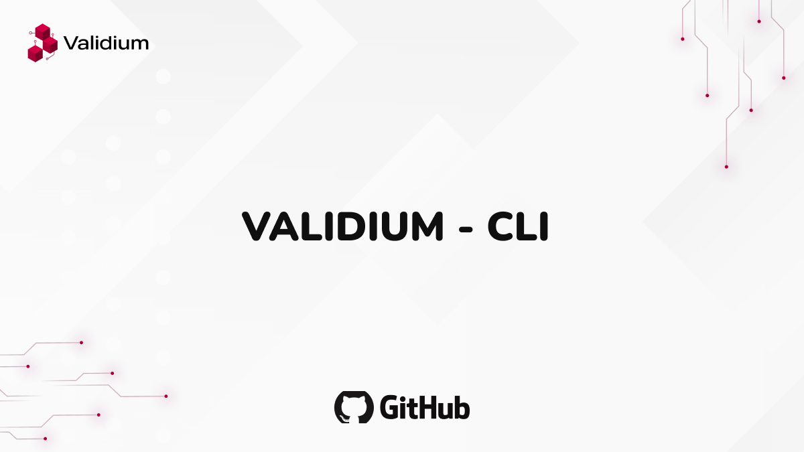
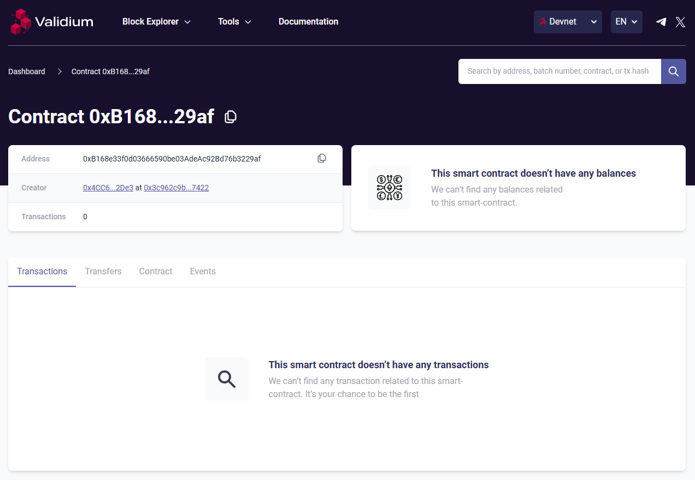
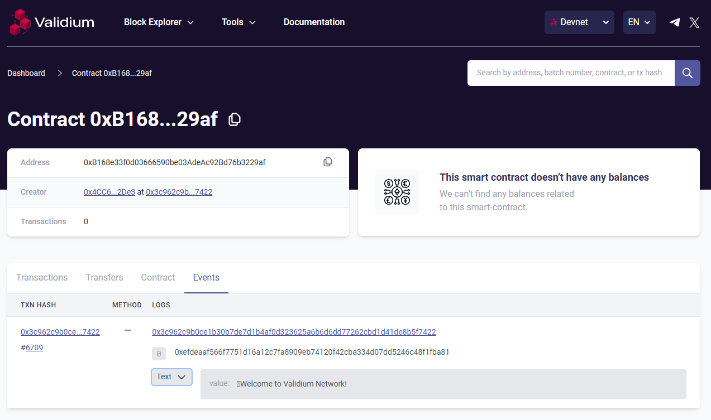
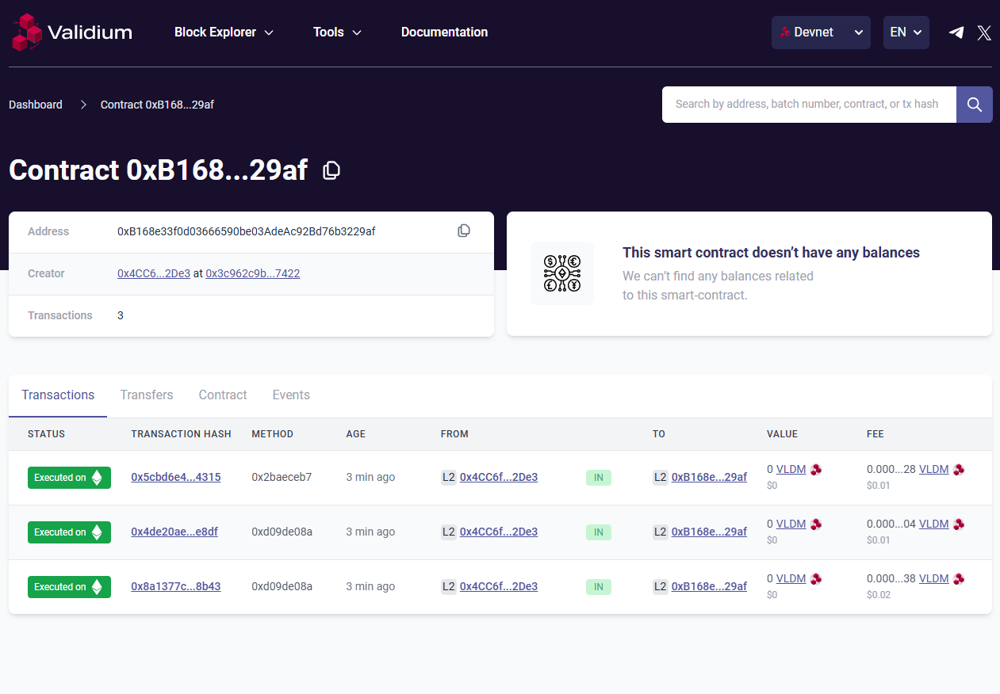

<div align="center">
  
</div>

# Validium CLI

## Deploy a smart contract to Validium using the validium-cli in under 5 minutes

This Page shows you how to deploy and interact with a smart contract on Validium in less than 5 minutes. It will help you get familiar with the Validium smart contract development and deployment process using validium-cli.

Content:

- Build a smart contract named Counter.
- Deploy the smart contract to the Validium Testnet.
- Interact with the contract using validium-cli.

## Prerequisites

1. Before you start, make sure that you’ve configured the [Validium Testnet in your wallet](https://validium.gitbook.io/docs/connect-to-validium#add-validium-to-your-metamask-wallet).
2. Have at least 0.5 Validium Testnet VLDM. If you need more, use one of the [faucets](https://testnet.faucet.validium.network/).

## `validium-cli`

Syntax:

```
npx validium-cli create <project-name>
```

### Create Validium Project

1. Use the command below to create a project

```git
npx validium-cli create my-project
```

2. Move to the just created project:

```
cd my-project
```

3. Create a `.env` file and add these environment variables:

```
WALLET_PRIVATE_KEY=
INFURA_API_KEY=
```

Add your account wallet private key here using which you want to deploy and interact with your contract. Also, you will need the [Infura](https://developer.metamask.io/login) API key with the Holesky network enabled (the Underlying Ethereum network).

### Review the Smart Contract

Review the contract inside `contracts` folder:

_Counter.sol_

```solidity
// SPDX-License-Identifier: MIT
pragma solidity ^0.8.24;

contract Counter {
    uint256 public count = 0;

    // Events
    event Greet(string);
    event CountUpdated(uint256);

    constructor() {
        // initializes the contract with a welcome message
        emit Greet("Welcome to Validium Network!");
    }

    function increment() public {
        count += 1;
        emit CountUpdated(count);
    }

    function decrement() public {
        require(count > 0, " UNDERFLOW: CANNOT DECREASE ANYMORE!");
        count -= 1;
        emit CountUpdated(count);
    }

    function addToCount(uint256 _value) public {
        count += _value;
        emit CountUpdated(count);
    }

    function getCount() public view returns (uint256) {
        return count;
    }
}
```



The Solidity smart contract contains four functions:

- `increment` increases the value of the count state by 1 and emits the `CountUpdated` event.
- `decrement` decreases the value of the count state by 1 and emits the `CountUpdated` event.
- `addToCount` adds a value `_value` to the count state and emits the `CountUpdated` event.
- `getCount` returns the current value of the count state.

Validium is EVM compatible. You can write smart contracts with Solidity or Vyper and use existing popular libraries like OpenZeppelin, just like on Ethereum.

### Compile and Deploy the Smart Contract

1. Use this command to compile the smart contract:

```
npx validium-cli compile
```

It will compile and generate an artifacts folder named `artifacts-zk` .\
Logs:

```
$ npx validium-cli compile

[INFO]: Starting compilation...
[INFO]: Setting up compilation environment...

Compiling contracts for ZKsync Era with zksolc v1.5.12 and zkvm-solc v0.8.24-1.0.1
Compiling 2 Solidity files
Successfully compiled 2 Solidity files
```

> It shows: `Successfully compiled 2 Solidity files`, becuase in the `contracts` folder we have two contracts, `Counter.sol` and `MessageBoard.sol,` here we are taking the example of `Counter.sol` only.

2. Deploy to Validium Testnet:

syntax:

```
npx validium-cli deploy
```

If you want to create your own script to deploy the compiled smart contract then add your `<script-file>` path after the command.

```
npx validium-cli deploy <script-file>
```

It will ask to select the contract to deploy from the list of 'compiled contracts'.

```
$ npx validium-cli deploy

[INFO]: Starting deployment...
[INFO]: Setting up deployment environment...

? Select a compiled contract to deploy: » - Use arrow-keys. Return to submit.
>   Counter.sol
    MessageBoard.sol
```

Select `Counter.sol` as we are working with this contract now. I will again prompt to enter the constructor arguments (in the smart contract we have none), so simply return empty.

```
$ npx validium-cli deploy

[INFO]: Starting deployment...
[INFO]: Setting up deployment environment...

√ Select a compiled contract to deploy: » Counter.sol
? Enter the constructor arguments separated by commas (if any): »
```

This will deploy the compiled contract to the Validium Testnet.

Logs:

```
$ npx validium-cli deploy

[INFO]: Starting deployment...
[INFO]: Setting up deployment environment...

√ Select a compiled contract to deploy: » Counter.sol
√ Enter the constructor arguments separated by commas (if any): ...

Starting deployment process of "Counter"...
Estimated deployment cost: 0.000019009462581388 ETH

"Counter" was successfully deployed 🎉:
 - Contract address: 0xB168e33f0d03666590be03AdeAc92Bd76b3229af
 - Contract source: contracts/Counter.sol:Counter
 - Encoded constructor arguments: 0x

 - See on Validium Block Explorer: https://testnet.explorer.validium.network/address/0xB168e33f0d03666590be03AdeAc92Bd76b3229af

```

Piece of cake right? 🎊

### Check the Contract in Validium Block Explorer

Use the contract address from the deployment logs to see the deployed contract on the [Validium Block Explorer](https://testnet.explorer.validium.network/) or use the link from the logs directly.

<figure><figcaption><p>Deployed contract on Validium Block Explorer</p></figcaption></figure>

You can also move to the Events tab and see the `Greet` event emitted through the constructor as a result of deployment:

<figure><figcaption><p>Events tab showing the Greet Event value in Text format</p></figcaption></figure>

### Interact with the Deployed Contract

1. Go to `interact.ts` file inside `deploy` folder:

syntax:

```
npx validium-cli interact
```

If you want to create your own script to interact with the deployed smart contract then add your `<script-file>` path after the command.

```
npx validium-cli interact <script-file>
```

It will ask to select the contract to deploy from the list of 'compiled contracts'.

```
$ npx validium-cli interact

[INFO]: Starting interaction...

? Select a compiled contract to interact with: » - Use arrow-keys. Return to submit.
>   Counter.sol
    MessageBoard.sol
```

Select `Counter.sol` as we are working with this contract for now. I will prompt to enter the deployed contract address (copy from the deployments logs, it can also be found inside the `deployments-zk` folder). After providing the deployed contract address, it wil prompt to ask `Select an action` .

```
$ npx validium-cli interact

[INFO]: Starting interaction...

√ Select a compiled contract to interact with: » Counter.sol
√ Enter the deployed contract address: ... 0xB168e33f0d03666590be03AdeAc92Bd76b3229af
Running script to interact with contract 0xB168e33f0d03666590be03AdeAc92Bd76b3229af
? Select an action: » - Use arrow-keys. Return to submit.
    Call a function (state-changing)
>   Call a view/pure function (read-only)
    Exit
```

Select `Call a view/pure function (read-only)`, it will list the available functions which can be executed under this selection, then select `getCount` to view the initial state of the `count` . After this call it will again prompt to ask `Select an action` .&#x20;

```
...
Running script to interact with contract 0xB168e33f0d03666590be03AdeAc92Bd76b3229af
√ Select an action: » Call a view/pure function (read-only)
√ Select a view/pure function to call: » getCount
Calling getCount()...
Result: 0
? Select an action: » - Use arrow-keys. Return to submit.
>   Call a function (state-changing)
    Call a view/pure function (read-only)
    Exit

```

This time select `Call a function (state-changing)` , it will list the available functions which can be executed. Select `addToCount` and provide any value (say 5).

```
...
√ Select an action: » Call a function (state-changing)
√ Select a function to call: » addToCount
√ Enter arguments for addToCount (comma-separated): ... 5
Calling addToCount(5)...
Tx hash: 0x313a941e8dca4cc2e04fe65c8adcd6170a1900d154d536a04f8a7410fdce0d1a
addToCount executed!
? Select an action: » - Use arrow-keys. Return to submit.
>   Call a function (state-changing)
    Call a view/pure function (read-only)
    Exit

```

After execution, again select `Call a view/pure function (read-only)` and call `getCount` .

```
...
√ Select an action: » Call a view/pure function (read-only)
√ Select a view/pure function to call: » getCount
Calling getCount()...
Result: 5
? Select an action: » - Use arrow-keys. Return to submit.
>   Call a function (state-changing)
    Call a view/pure function (read-only)
    Exit
```

Tada! 🎉 State updated!&#x20;

Try this a couple of times more and then check the transactions in Validium Block Explorer:

<figure><figcaption><p>Three transactions which was triggered from the interact command</p></figcaption></figure>

### Takeaways <a href="#takeaways" id="takeaways"></a>

- **`validium-cli`:** This CLI tool streamlines deployment and facilitates seamless interaction with the Validium Network.
- **EVM-compatibility**: Validium is EVM-compatible and you can write smart contracts in Solidity or Vyper as in Ethereum.
- **Custom compilers**: smart contracts deployed to Validium must be compiled with the customs compilers: `zksolc` for Solidity and `zkvyper` for Vyper.

### Next steps <a href="#next-steps" id="next-steps"></a>

- Follow the same above steps to deploy your contract, changes can be made to `interact.ts` file and use your methods from the contract.
- Continue learning by [Deploy using Quickstart Repository](https://validium.gitbook.io/docs/start-coding/quickstart/deploy-using-quickstart-repository).
